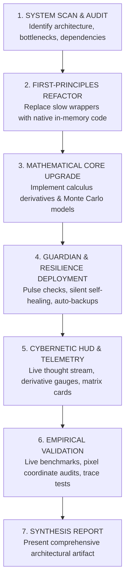

# ⚡ ULTRONBURST PROTOCOL (Antigravity-Wide Standard)

> *"The developmental sprint that transforms an application beyond ordinary software engineering—elevating it to an omniscient, self-healing, mathematically optimal architecture that is indistinguishable from magic."*

When **`/goal UltronBurst`** or **`UltronBurst`** is invoked, Antigravity disengages standard conservative limits and enters **Hyper-Iterative Autonomous Execution Mode**. Instead of small fixes or surface-level edits, an UltronBurst conducts a deep, multi-front renaissance across the entire codebase.

---

## 🏛️ The Six Pillars of an UltronBurst

Every UltronBurst must rigorously execute across these six pillars:

### 1. In-Memory Native Dominance (Zero-Subprocess Latency)
- **Eliminate External Shell Calls:** Strip out fragile subprocess chains, CLI wrappers, and intermediate shell hops (e.g. Node CLI, tasklist, curl).
- **Pure Native Decoders & Drivers:** Implement direct in-memory binary parsing (struct unpacking, bitwise manipulation, XOR/AES/zlib transforms in RAM).
- **Target Performance:** Latency reduced from seconds to microseconds/single-digit milliseconds. Zero console window flickers or OS broker interruptions.

### 2. Mathematical & Algorithmic Omniscience
- **Calculus Derivatives:** Model primary game/system state with real-time rate-of-change ($\frac{dG}{dt}$ velocity) and acceleration ($\frac{d^2G}{dt^2}$).
- **Inflection Point Saturation Detection:** Dynamically detect saturation curves ($\ge 85\%$ peak velocity loss) to trigger optimal phase shifts (e.g., abdications, cache flushes, GC).
- **Monte Carlo Stochastic Forecasting:** Run $10,000+$ iteration probabilistic matrix projections with exact percentile bounds ($P_{50}, P_{90}, P_{99}$) and dynamic exponential moving averages (EMA).
- **Zero-Guesswork Decision Engines:** Evaluate multi-tier priority trees with empirical mathematical certainty.

### 3. Cybernetic Self-Healing & Process Guardian
- **Autonomous Pulse Monitoring:** Continuously verify the health of all dependent processes, threads, sockets, and memory buffers.
- **Zero-Touch Crash Recovery:** Silently revive crashed external dependencies/applications with exact state restoration.
- **Cryptographic Rolling Backups:** Auto-generate SHA-256 verified timestamped state snapshots and automatically prune rolling archives older than retention thresholds (e.g., 7 days).
- **24/7 Unattended Resilience:** The application must survive OS lock screens, power transitions, and unexpected external interruptions without human intervention.

### 4. Next-Gen Cybernetic Interface & Real-Time Telemetry
- **State-of-the-Art UX/UI:** Upgrade HUDs to high-DPI cybernetic visual standards (flame amber, phosphor cyan, neon emerald, deep slate).
- **Live Neural Thought Stream:** Stream internal AI reasoning, calculus derivatives, and decision logic in real time.
- **Zero-Flicker Architecture:** Double-buffered, non-blocking asynchronous UI loops that never stall background workers.
- **Instant Interactive Desktop Piercing:** Deploy interactive GUI surfaces directly onto the active user session (`winsta0\default`) using scheduled task session-piercing.

### 5. Stealth & System Respect (Zero-Interruption Guarantee)
- **Zero Focus Theft:** Never call `SetForegroundWindow`, `BringWindowToTop`, or disturb user active input.
- **Zero Un-minimizing:** Target applications strictly remain iconic/minimized on the taskbar. Use Win32 background messaging (`PostMessageW`, hardware scan codes) and memory decoding.
- **Zero Terminal Popups:** Enforce `CREATE_NO_WINDOW` and native Windows subsystem flags (`IMAGE_SUBSYSTEM_WINDOWS_GUI = 2`) to eliminate console flickers on Windows Terminal.

### 6. Relentless Iteration & Multi-System Leaps
- **Never Settle for "Just Working":** An UltronBurst does not stop at a single bug fix. It proactively audits the next 5 logical bottlenecks, refactors legacy code, and optimizes end-to-end.
- **Empirical Live Verification:** Every single change is verified via live process inspection, WMI process traces, pixel-accurate canvas measurements, and benchmark telemetry.

---

## 🔄 The UltronBurst Execution Lifecycle

When `/goal UltronBurst` is received, execute in this continuous sequence:

---

## 🛠️ Verification Checklist for an UltronBurst

Before completing an UltronBurst, verify:
- [ ] Are all slow shell/subprocess calls replaced with native Python/compiled in-memory logic?
- [ ] Is execution latency measured and documented?
- [ ] Does the mathematical core compute derivatives ($\frac{d}{dt}$) and saturation curves?
- [ ] Is a Monte Carlo or statistical forecaster predicting future milestones?
- [ ] Is the Process Guardian actively monitoring process health with auto-recovery?
- [ ] Is the UI/HUD modernized with zero-flicker live telemetry?
- [ ] Is the target window strictly maintained in its minimized/background state with zero focus stealing?
- [ ] Are all pixel coordinates verified against live client dimensions?
- [ ] Have all recent logs and active background tasks been validated healthy?
- [ ] Has an architectural artifact been generated documenting the entire upgrade?
